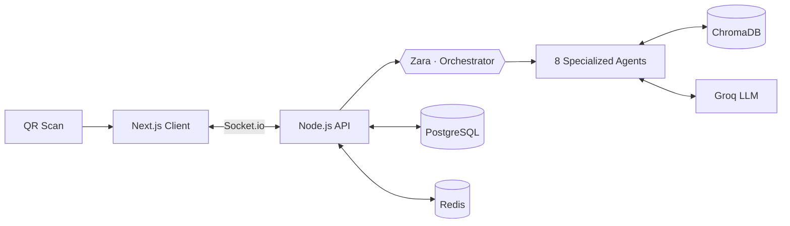
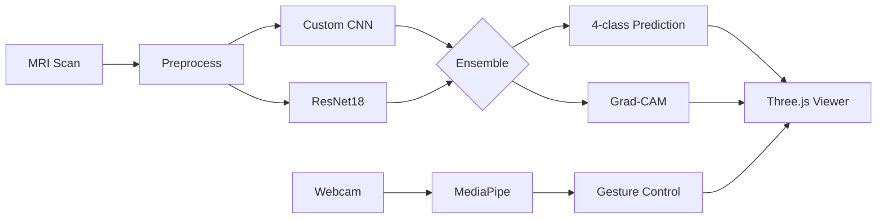

<div align="center">





<br/>

<a href="https://git.io/typing-svg">
  
</a>

<br/>

<a href="https://www.linkedin.com/in/ayush-raj-tiwary-3b4392227"></a>
<a href="mailto:ayushratiwary07@gmail.com"></a>


</div>

---

### `$ cat ~/about.ts`

```ts
const ayush = {
  name         : "Ayush Raj Tiwary",
  degree       : "B.Tech CSE @ 2023–2027",
  location     : "India 🇮🇳",
  stack        : ["Next.js", "Node.js", "FastAPI", "Python", "PostgreSQL", "ChromaDB", "Groq AI"],
  currentFocus : "Shipping full-stack + multi-agent AI systems",
  funFact      : "I bowl more overs than I close PRs 🏏",
  status       : "open_for_internships_and_collabs", // pings welcome
} as const;
```

---

### `$ tree ~/projects`

```text
~/projects
├── 🍛 spice-garden/        AI-driven smart dining assistant
│   ├── scan QR → chat with Zara → order food. zero staff.
│   ├── 8 specialized AI agents · real-time group ordering · multilingual
│   └── Next.js · Node · PostgreSQL · ChromaDB · Groq · LangChain.js · Redis · Socket.io
│
└── 🧠 neuro-core/          brain tumor MRI detection + gesture control
    ├── custom CNN + fine-tuned ResNet18 → 4 tumor types @ 94.81% accuracy
    ├── Grad-CAM heatmaps · hands-free control via MediaPipe
    └── Python · PyTorch · FastAPI · OpenCV · Three.js
```

<div align="center">

[](https://smart-dinning-assistent.vercel.app)
[](https://smart-dinning-assistent.vercel.app/admin)
[](https://github.com/ARTiwary/smart-dinning-assistent)
<br/>
[](https://brain-tumor-with-gesture.netlify.app/)
[](https://github.com/ARTiwary/MRI-brain-tumour-detection-with-gesture-control-)

</div>

<details>
<summary><code>$ ./show-architecture.sh</code></summary>

<br/>





</details>

---

### `$ ls ~/skills`

<div align="center">

<br/>
<br/>
<sub><code>also: ChromaDB · Groq API · LangChain.js · Ollama · MediaPipe</code></sub>

</div>

---

### `$ git log --stat`

<div align="center">


<br/>


<br/><br/>


</div>

---

### `$ ./snake --eat contributions`

<div align="center">
  <picture>
    <source media="(prefers-color-scheme: dark)" srcset="https://raw.githubusercontent.com/ARTiwary/ARTiwary/output/github-snake-dark.svg" />
    <source media="(prefers-color-scheme: light)" srcset="https://raw.githubusercontent.com/ARTiwary/ARTiwary/output/github-snake.svg" />
    
  </picture>
</div>

---

### `$ cat ~/.config/life.yml`

```yaml
hobbies:
  - 🏏 Cricket    — bowling all-rounder (clean action, good line)
  - ✏️ Sketching  — stress reset + creative outlet
  - 🤝 Brainstorming with teams until 2am

mindset:
  - "Systems thinking > firefighting"
  - "Build it. Ship it. Improve it."
  - "Every bug is just a feature not yet understood"
  - "$0 infra bills are an engineering achievement"
```

<div align="center">

<br/>

```text
$ echo "Learn every day. Build with passion. Grow without limits."
$ exit 0
```


</div>