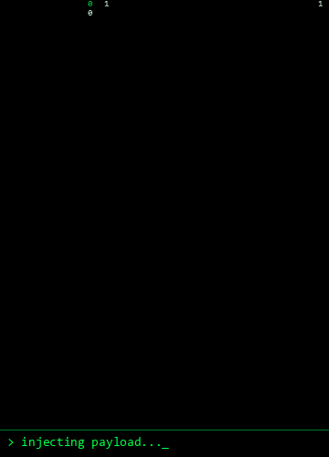

<div align="center">


<a href="https://git.io/typing-svg"></a>

<br/>

<a href="https://www.linkedin.com/in/ayush-raj-tiwary/"></a>
<a href="mailto:ayushratiwary07@gmail.com"></a>


</div>

---

<table>
<tr>
<td width="40%" align="center">

</td>
<td width="60%" valign="top">

```text
root@ayush:~$ whoami
ayush-raj-tiwary        # B.Tech CSE '27 - full-stack + AI

root@ayush:~$ ls ./projects
spice-garden/   neurocore/

root@ayush:~$ cat status.txt
[ OK ] 8 AI agents online
[ OK ] webcam tracking hands
[ OK ] infra bill: $0.00
[ >> ] open for internships and collaborations

root@ayush:~$ cat offline.txt
cricket (bowling all-rounder)
pencil sketching
brainstorming until 2am
```

</td>
</tr>
</table>

---

## `$ ./run projects --featured`

<table>
<tr>
<td width="50%" valign="top">

### >> SPICE GARDEN
**AI-driven smart dining assistant**

Scan a QR code at the table and chat with **Zara**, an AI waiter that understands English, Hinglish and Telugu-English, remembers returning guests, and warns about allergens before anything reaches the cart.

```text
agents ........ 8
features ...... 25+
infra cost .... $0 / month
```

- Multi-agent orchestrator (LangChain.js + Groq)
- Real RAG: Cohere embeddings + pgvector search
- Real-time group ordering (Socket.io + Redis)
- Admin dashboard, kitchen display, reservations, Razorpay, PWA

`Next.js 16` `Node.js` `PostgreSQL` `pgvector` `Redis` `Prisma` `Groq` `Cohere`

[Live demo](https://smart-dinning-assistent.vercel.app/table/T1) | [Source code](https://github.com/ARTiwary/smart-dinning-assistent)

</td>
<td width="50%" valign="top">

### >> NEUROCORE
**Brain tumour MRI detection with gesture control**

A contactless diagnostic interface for radiologists who can't break sterile gloves. Three independently trained models, Grad-CAM heatmaps that show why the model decided, and hands-free control through in-browser MediaPipe hand tracking.

```text
best accuracy . 95.75% (EfficientNet-B0)
models ........ 3 (CNN, ResNet-18, EffNet)
extra hardware  none (just a webcam)
```

- Pinch to click, dwell to select, two-hand scroll and zoom
- Bootstrap 95% confidence intervals, per-class sensitivity
- Honest limits: glioma sensitivity gap is documented, and it is a research prototype, not a clinical tool

`PyTorch` `FastAPI` `MediaPipe` `OpenCV` `Grad-CAM` `Three.js` `Groq`

[Live demo](https://brain-tumor-with-gesture.netlify.app/) | [Source code](https://github.com/ARTiwary/MRI-brain-tumour-detection-with-gesture-control-)

</td>
</tr>
</table>

---

## `$ cat stack.txt`

<div align="center">


</div>

---

## `$ git log --stats`

<div align="center">


</div>

---

```text
root@ayush:~$ echo $MOTTO
"Learn every day. Build with passion. Grow without limits."

root@ayush:~$ exit
```

<div align="center">


</div>