


 

**[Portfolio](https://artiwary.vercel.app/)** &nbsp;·&nbsp; **[LinkedIn](https://www.linkedin.com/in/ayush-raj-tiwary/)** &nbsp;·&nbsp; **[HackerRank](https://www.hackerrank.com/profile/ayushrajtiwary07)** &nbsp;·&nbsp; **[ORCID](https://orcid.org/0009-0009-3038-5216)** &nbsp;·&nbsp; **[Email](mailto:ayushratiwary07@gmail.com)**

 

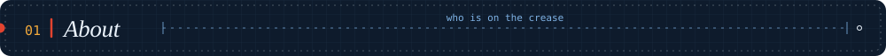

 

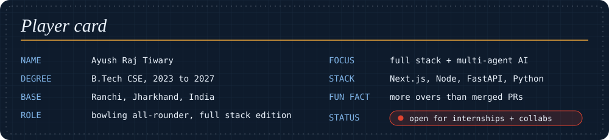

 

I build full stack products and teach machines to do useful things, mostly in Next.js, Node and Python. I like systems that work without supervision: a restaurant that runs on a chat, a scanner that reads MRIs, a viewer you steer with your hand. Off the keyboard I bowl, and I try to keep the same line and length in my code.

 

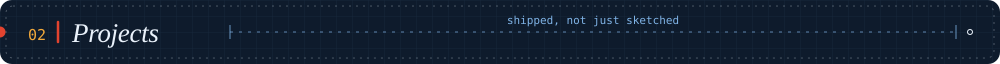

 

<table>
  <tr>
    <td width="50%" valign="top">
      <a href="https://smart-dinning-assistent.vercel.app">
        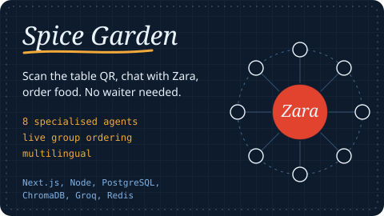
      </a>
      

        <a href="https://smart-dinning-assistent.vercel.app"><b>Live</b></a> &nbsp;·&nbsp;
        <a href="https://smart-dinning-assistent.vercel.app/admin"><b>Admin panel</b></a> &nbsp;·&nbsp;
        <a href="https://github.com/ARTiwary/smart-dinning-assistent"><b>Source</b></a>
      

    </td>
    <td width="50%" valign="top">
      <a href="https://brain-tumor-with-gesture.netlify.app/">
        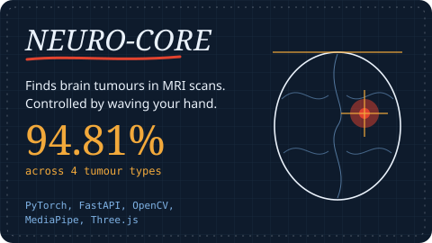
      </a>
      

        <a href="https://brain-tumor-with-gesture.netlify.app/"><b>Live</b></a> &nbsp;·&nbsp;
        <a href="https://github.com/ARTiwary/MRI-brain-tumour-detection-with-gesture-control-"><b>Source</b></a>
      

    </td>
  </tr>
</table>

<b>How they are wired</b> &nbsp;(architecture diagrams, click to open)

 

**Spice Garden**

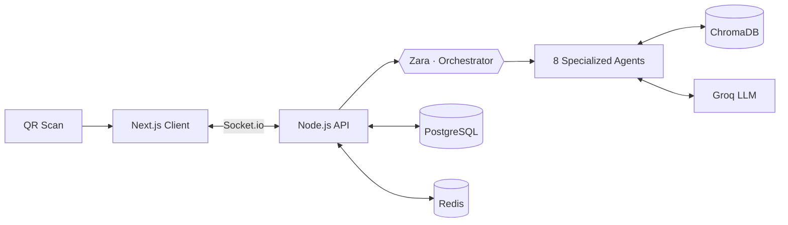

**NEURO-CORE**

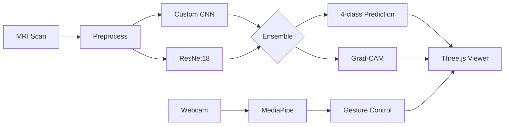

**Also in the pavilion:** &nbsp;
[portfolio](https://github.com/ARTiwary/portfolio) (my site, AI/ML and full stack work) &nbsp;·&nbsp;
[Air-gesture-recognition](https://github.com/ARTiwary/Air-gesture-recognition) (hand gestures in JavaScript)

 

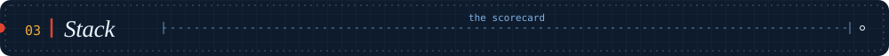

 


 

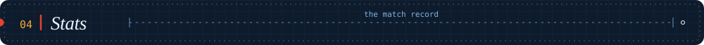

 

 

 

 

 

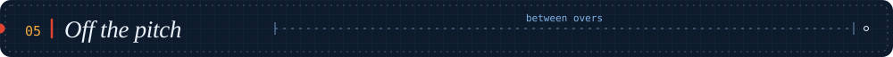

 

<table>
  <tr>
    <td width="50%" valign="top">

**Between overs**

- 🏏 **Cricket**: bowling all-rounder, clean action, good line
- ✏️ **Sketching**: stress reset and creative outlet
- 🤝 **Brainstorming** with teams until 2am

</td>
    <td width="50%" valign="top">

**House rules**

- Systems thinking over firefighting
- Build it. Ship it. Improve it.
- Every bug is a feature not yet understood
- A $0 infra bill is an engineering achievement

</td>
  </tr>
</table>

 

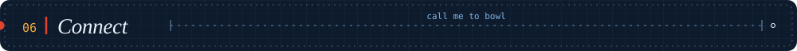

 

Open to internships and collaborations, especially full stack and applied AI. If something here caught your eye, my inbox is open.

 

  

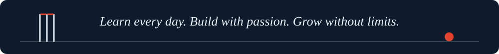

 

